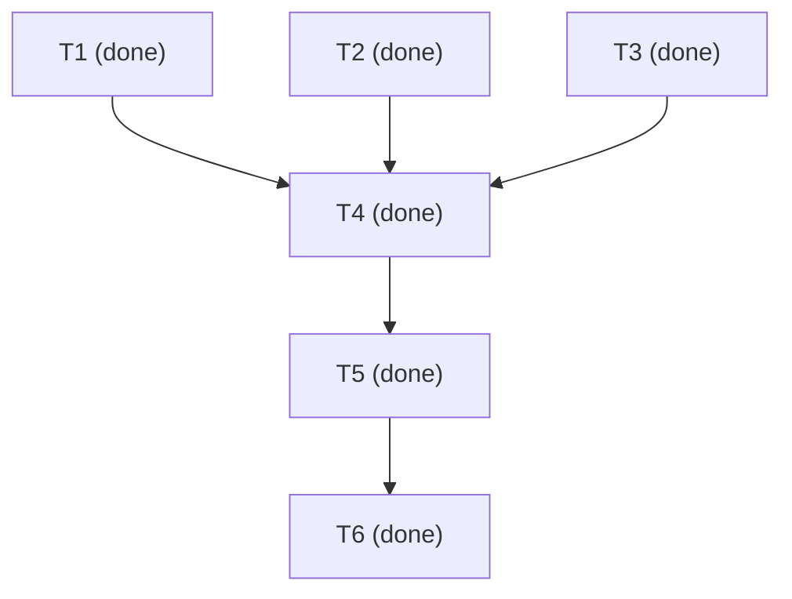

# 변경 대응 구현 Task와 검증

- 단계: 요구·설계·Task 및 수정 후 독립 개발 리뷰 PASS. T1–T6 완료. 구현·검증·사용 문서 인계.
- 범위: [요구 R1–R9](requirement.md#확정-구현-계약), [설계](architecture.md). 합의 Q1–Q6 재질문 없음.
- 통합 담당: /root. 공유 루트 `/home/minjae/ws/gamjagoon-skills-pack/.gsp-work`, lead record `sessions/session-change-design-b4f5n7ax/work.md`.
- 기준: HEAD `bd656b1eed3d7800b7162ce97ea4dec0e5081540` + 기존 dirty. `implementation-baseline.json`에 16개 소스 해시. 다른 변경 유지.
- 병렬 수 3: 실제 계획상 DAG worker, coordinator worker, lead의 독립 소유 작업 3개. 전역 기본값이 아니다. 독립 reviewer는 구현 완료 후 별도 읽기 전용 단계.
- 시간/비용 추정: 미지정. 새 유료 서비스·추가 패키지·자동 모델 turn 없음. 동일한 검사 반복보다 실제 변경 영향에 맞춰 검증한다.

## 목차

- [작업](#작업)
- [DAG](#dag)
- [Task 계획 리뷰](#task-계획-리뷰)
- [실행과 검증](#실행과-검증)
- [개발 리뷰](#개발-리뷰)
- [전달과 제한](#전달과-제한)

## 작업

| ID | 요구/설계 연결 | 완료 기준과 검증 | 상태 |
| --- | --- | --- | --- |
| T1 | R2–R5, 변경 처리와 DAG v2 | v1 회귀 유지, v2 stale/hold/소비자 차단, running 보류 표시, 재검증 경계/수용 검사. malformed·future refs·hold 우회·독립 배정 CLI 검증 | done (후보) |
| T2 | R4/R6–R8, 세션 조정 계약·연결 | 등록→게시→전송/대기→held/applied→resolve, 잘못된 revision/ACK 거부, 멱등·미등록·손상·동시 기록·중단 후 복구. synthetic socket과 실제 격리 initialize로 증거 분리 | done (후보/정적) |
| T3 | R1/R6/R7/R9, 구성 책임 | 기존 모든 스킬/reviewer에서 공통 절차 연결, 같은 VM 무설치 사용 문서, allowlist·CLI/noise/backup/rollback 테스트 작성과 정적 확인; 실제 실행은 T4 | done (후보/정적) |
| T4 | R1–R9, 검증과 소유권 | 후보 기준 비교 후 lead만 원본 통합. installed CLI 경로, 전체 관련 회귀, CM-A1 r5/r6, pending ACK gate/새 event 독립성, 격리 실제 Codex 연결. 설치가 daemon/모델을 시작하지 않는지 확인 | done |
| T5 | R1–R9 | native gsp-reviewer mode development, 실제 코드/통합 증거 직접 검토. 확인된 결함은 원래 재현 조건 수정·재검증 후 종결 | done |
| T6 | R1–R9 | 현재 Task 완료·검증 상태/소스 해시/링크 재확인, 사용 명령과 미검증 환경 명시, 세션 기록 갱신 | done |

후보 소유는 T1 `/tmp/gsp-change-dag-5xnauojj`, T2 `/tmp/gsp-change-control-by4epfqr`. 의도적인 allowlist 복사본으로 dirty 파일의 현재 상태를 전달했다. 각 worker는 자기 후보와 shared root의 자기 기록만 쓰며 원본에 적용하지 않는다. `candidates.json`에 복사 기준 해시를 보관한다. T2는 확정된 parse_document/validate/route/check API로 구현하며 T1의 v2 코드가 도착하면 격리 후보에 반영해 결합 검증한다. 전체 통합은 T4다.

설치본 실제 연결 불가 시 자동 설치/daemon 시작을 하지 않고 A 원인과 상태를 보고한다. 실험은 자기 임시 서버/경로만 사용하며 사용자 thread나 모델 turn은 시작하지 않는다. 모델 worker의 실제 보류 행동 및 대상 VM 환경은 NOT_RUN으로 분리한다.

## DAG

<!-- GSP-DAG:START -->
```json
{
  "version": 1,
  "max_parallel": 3,
  "tasks": [
    {
      "id": "T1",
      "title": "개정 기반 DAG v2와 현재 수용 검사",
      "owner": "dag-worker",
      "deps": [],
      "status": "done",
      "reads": [
        "spec/change-management/requirement.md",
        "spec/change-management/architecture.md"
      ],
      "writes": [
        ".agents/skills/gsp-tasks/scripts/task_dag.py",
        ".agents/skills/gsp-tasks/references/task-dag.md",
        "tests/test_task_dag.py"
      ],
      "resources": [],
      "evidence": "격리 후보 27 tests PASS, v1 differential 120 graphs PASS; CM-A2 chain/diamond/hold tests. session-dag-v2-6y5wzx4j/work.md; 원본 통합은 T4"
    },
    {
      "id": "T2",
      "title": "로컬 VM 세션 조정 CLI와 전송/복구",
      "owner": "control-worker",
      "deps": [],
      "status": "done",
      "reads": [
        "spec/change-management/requirement.md",
        "spec/change-management/architecture.md"
      ],
      "writes": [
        ".agents/skills/gsp-development/scripts/session_control.py",
        ".agents/skills/gsp-development/references/session-control.md",
        "tests/test_session_control.py"
      ],
      "resources": [],
      "evidence": "격리 후보 21 behavior tests PASS; session-control-xNjpIT3M/work.md. 실제 모델/대상 VM NOT_RUN"
    },
    {
      "id": "T3",
      "title": "공통 변경 절차와 스킬/설치 연결",
      "owner": "lead",
      "deps": [],
      "status": "done",
      "reads": [
        "spec/change-management/requirement.md",
        "spec/change-management/architecture.md"
      ],
      "writes": [
        "AGENTS.md",
        "README.md",
        "install.sh",
        ".codex/agents/gsp-reviewer.toml",
        ".agents/skills/gsp-development/references/change-management.md",
        "tests/test_install.py",
        ".agents/skills/gsp-adopt/SKILL.md",
        ".agents/skills/gsp-grilling/SKILL.md",
        ".agents/skills/gsp-requirements/SKILL.md",
        ".agents/skills/gsp-architecture/SKILL.md",
        ".agents/skills/gsp-tasks/SKILL.md",
        ".agents/skills/gsp-development/SKILL.md",
        ".agents/skills/gsp-development/references/session-work.md",
        ".agents/skills/gsp-development/references/parallel-work.md"
      ],
      "resources": [],
      "evidence": "6 skills/common refs/AGENTS/reviewer/README/allowlist/test 작성; bash -n, git diff --check, frontmatter/TOML/Python3.9 syntax PASS. 설치 실행 T4"
    },
    {
      "id": "T4",
      "title": "후보 통합과 실제 설치/연결/회귀 검증",
      "owner": "lead",
      "deps": [
        "T1",
        "T2",
        "T3"
      ],
      "status": "done",
      "reads": [
        "."
      ],
      "writes": [
        ".agents",
        "tests",
        "install.sh"
      ],
      "resources": [],
      "evidence": "통합 27 DAG + 21 coordinator + 7 installer = 55 PASS; 79 links/static PASS; 실제 isolated Codex canonical socket doctor exit0, UID/PID 확인. actual-transport-pass.json/integrated-tests.json"
    },
    {
      "id": "T5",
      "title": "독립 개발 리뷰 및 결함 종결",
      "owner": "reviewer",
      "deps": [
        "T4"
      ],
      "status": "done",
      "reads": [
        "."
      ],
      "writes": [],
      "resources": [],
      "evidence": "native gsp-reviewer: initial FAIL CM-D1, corrected3files targeted PASS; original alias repro +25 coordinator+7 installer independent PASS; CM-A1/A2 closed"
    },
    {
      "id": "T6",
      "title": "최종 기준 검사와 사용자 인계",
      "owner": "lead",
      "deps": [
        "T5"
      ],
      "status": "done",
      "reads": [
        "."
      ],
      "writes": [
        "spec/change-management"
      ],
      "resources": [],
      "evidence": "final-checks.json: reviewed source20 unchanged, local links89 PASS, Python3.9 grammar/TOML PASS; CM-D1 independent closed; use/evidence/NOT_RUN handed off"
    }
  ]
}
```
<!-- GSP-DAG:END -->



## Task 계획 리뷰

- native gsp-reviewer, mode tasks, 독립 읽기 전용 PASS. R1–R9/T1–T6 차단 사항 없음.
- CM-T1: 비어 있던 reads를 T1–T3 요구/설계, T4–T6 전체 확인 범위로 보완. 독립 validate/route/render 재검증에서 T1/T2/T3 배정과 파생 그래프 일치 확인.
- 기준: Task SHA256 `aaacb7d24293f19d5ab1b5f1c4e2b50cf776a824508b5508df21dc238f69cac1`, 설계 `ab06528007b7838fe626e079f11ac97bf89b6648f9a21f9440616d0c4411668c`.
- 영향 설계 재검토: 과거 acceptance 개정은 현재 미충족이며 전역 구조 오류가 아니라는 계약도 독립 확인. 구현 성공 판정은 아님.

## 실행과 검증

실제 원본 통합 상태에서 Python 3.13.14, Linux UID 1000으로 실행했다. 명령의 테스트 입력/기대는 소스 테스트와 [설계](architecture.md)에 있으며 아래는 관측 결과다.

| 검사 | 관측 결과 | 증거 종류 |
| --- | --- | --- |
| `python3 -B tests/test_task_dag.py -v` | 27/27 PASS. v1 보존, stale/hold/running 예약, CM-A2 역사적 체인·이중 경로, 현재 수용, exit codes | 실제 Python CLI/단위 실행 |
| `python3 -B tests/test_session_control.py -v` | 21/21 PASS. CM-A1 r5→r6, ACK·supersede, 소유/범위/문서 분리, 동시 ACK, corruption, timeout, restart/uncertain | 실제 로컬 CLI·합성 Unix WebSocket 서버. 모델 행동은 아님 |
| `python3 -B tests/test_install.py -v` | 7/7 PASS. 정확한 관리 파일 16개(.gitignore 포함), 잡파일 제외·backup·충돌·rollback, 설치된 v2/수동 조정 흐름 | 실제 임시 설치본 실행 |
| `bash -n install.sh`, `git diff --check` | PASS | 정적 |
| 로컬 Markdown 링크/앵커, Python 3.9 grammar, reviewer TOML, 6개 기존 단순 frontmatter | 79개 로컬 링크 포함 PASS | 정적. Python3.9 런타임 아님 |
| skill-creator `quick_validate.py` | PyYAML 없음으로 실행 실패. 추가 설치하지 않음. frontmatter/참조는 위 표준 라이브러리 확인으로 대체 | 제한된 정적 확인, 공식 validator 성공 아님 |
| 실제 배포용 coordinator `doctor` → 격리 Codex 0.166.0 | canonical Unix socket에서 exit0, mode B/initialized true. SO_PEERCRED PID/UID가 격리 서버/현재 UID와 일치 | 실제 Codex initialize 연결. thread/turn/model 호출 0 |

세부 결과는 `.gsp-work/sessions/session-change-design-b4f5n7ax/integrated-tests.json`, `actual-transport-pass.json`, `integrated-state.json`에 기록했다. 배포용 제품 코드에는 daemon 시작/설치, turn/thread 시작/resume, 강제 interrupt가 없다. 설치도 프로세스를 시작하지 않는다.

연결 시행착오는 보존했다. 최초 proxy JSONL 실험은 응답 없음. 초기 조사에서 daemon 탐색이 의도와 달리 전용 `/tmp` 아래 보조 패키지를 생성했고 해당 daemon은 종료했다. 사용자 환경/프로젝트는 변경하지 않았다. 이후 제품 CLI 검증은 direct app-server만 사용했고 추가 패키지 생성 없이 실행했다. 제품의 literal socket alias는 symlink 거부로 A 오류, 임시 경로 내부에만 socket이 있을 것이라는 검사도 실패했다. 실제 Codex가 `/tmp/codex-daemon-1000/...`에 소켓을 만들고 링크한다는 사실을 확인하고, PID/UID를 확인한 canonical 경로의 doctor가 성공했다. 소유/링크 거부 정책은 완화하지 않았고 사용 문서에 실제 경로 확인을 추가했다.

CM-A2: native reviewer가 최초 후보의 T1(old)→T2(old)→T3(current,revalidates T2) 미배정을 독립 재현했다. 경로별 stale 필터로 수정했고, 모든 hold·자신의 stale·다른 경로 stale 유지 및 재검증 완료 전후 수용을 원래 조건에서 실행했다. 수정 후 독립 종결 판정은 아래 개발 리뷰에서 기록한다.

T1 worker의 초기 v1 differential 120개 합성 그래프 동일 결과도 전달받았다. 통합의 독립 검증과 모델/대상 VM 검증을 대신하지 않는다.

## 개발 리뷰

### 최초 독립 리뷰 — FAIL

native gsp-reviewer가 20개 구현 파일과 원문/단계/증거를 직접 확인하고 별도 허용 목록 복사본에서 27+21+7=55개 테스트를 독립 실행했다. 검사 중 26개 소스/단계/증거 파일 불변을 확인했다. CM-A1과 CM-A2는 원래 재현 조건에서 독립 종결했다. 복합 PoC 시나리오에서 과거 BUILD→ARTIFACT done 이력 보존, API 변경 시 OPT running 보류 표시/예약, FEATURE 독립 배정, 안전 보류 후 RECHECK와 현재 수용을 확인했다.

| ID | 차단 | 요구·조건·영향 | 수정·재검증 |
| --- | --- | --- | --- |
| CM-D1 | 최초 차단 → 독립 종결 | R4/R8. 같은 tasks.md를 이중 슬래시 경로로 check하면 미해결 C1이 누락되어 exit0. canonical 경로는 exit1. 원문 경로 비교가 원인 | 모든 문서 진입점 정규화, 저장 identity 검사, 존재하는 hardlink 동일성 반영. 실제 CLI의 `//`, `/./`, leading `//`, 기존 저장 alias 오류/보존, 별도 문서 독립성 회귀 추가 |

저자 수정 후 coordinator 25/25 및 installer 7/7 PASS, git diff --check PASS. DAG 소스는 변경되지 않아 앞서 실행한 27/27 근거를 유지한다. 현재 관련 테스트 합계는 59개이며 원래 55개와 새 4개를 구분한다. 변경 파일은 coordinator 소스/테스트/참조 3개뿐이다. 정확한 수정 기준은 `review-state-fixed.json`, 실행 결과는 `cm-d1-recheck.json`에 보관한다. 이전 FAIL을 최신 PASS로 바꾸지 않았으며 다음 독립 재검토를 요청했다.

### 수정 후 독립 재검토

- 판정: native gsp-reviewer development 표적 재검토 PASS, CM-D1 종결. 최초 FAIL은 위에 보존한다.
- 원래 재현 재검사: canonical/`//`/`/./`/leading `//` 모두 ACK 미완료 시 exit1·C1 유지. held/applied와 명시적 resolve 후에만 모두 exit0.
- 독립 실행: coordinator 25/25, installer 7/7 PASS. 비정규 저장 identity 실패/원본 보존, 다른 문서 독립성, hardlink 비교, symlink/`..` 거부를 확인했다. DAG 27개와 CM-A1/A2는 변경되지 않은 이전 독립 증거를 유지했다.
- 기준: source `15d8aabd1dba82abb44c862e758dadfa489cfe7d84fc172f5121799c45d06315`, `review-state-fixed.json`의 20개 파일 + 보고서/증거 2개가 검사 전후 동일. 별도 복사본 `/tmp/gsp-cm-d1-review-r54htmqc`에서 실행. 원본 수정 없음.
- Lead 의견: 동일 파일의 표기 차이는 새 정본이 아니므로 gate 공유가 맞다. 수정은 별칭 우회를 닫고 다른 문서의 독립성을 유지한다. 초기 FAIL과 수정 후 PASS를 분리하고 실제 모델의 지시 준수나 대상 VM 검증으로 확대하지 않는다.
- 실제 Codex 초기화는 저자 실행 근거이며 reviewer는 모델/사용자 세션을 실행하지 않았다. 현재 요구 범위의 남은 차단 결함 없음.

## 전달과 제한

구현된 범위는 공통 변경 절차, DAG v2 현재 기준/수용 검사, 같은 Linux VM/계정의 선택형 조정 도구, 설치 및 사용 안내다. A가 기본이며 B는 명시적인 등록과 사용자 전경 프로세스로 실행한다. 사용법은 [세션 조정 안내](../../.agents/skills/gsp-development/references/session-control.md), [DAG 형식](../../.agents/skills/gsp-tasks/references/task-dag.md), [공통 변경 절차](../../.agents/skills/gsp-development/references/change-management.md)를 따른다.

PoC는 실제 격리 Codex 초기 연결에서 통과했다. pack의 합의 구현/로컬 검증 범위는 완료한다. 대상 VM 배포·실제 모델 worker의 안전한 보류/ACK·Python 3.9 런타임·다른 VM/계정/원격 제어는 NOT_RUN 또는 범위 밖이다. 금액·자원 사용량·성능 향상은 측정하지 않았으며 무비용 실행이라고 주장하지 않는다. OS/Python 추가 패키지 설치가 제품의 필수 조건은 아니다.

문서 이동 뒤 기존 경로가 사라진 경우 영구 inode 추적을 제공하지 않는다. 정본 이동은 기존 이벤트와 명시적으로 조정한다. 기존 파일과 다른 작업자의 변경을 보존했고 HTML을 생성하지 않았다. 배포 설치 자체는 source/지침만 전달하며 사용자 세션이나 coordinator를 시작하지 않는다.
