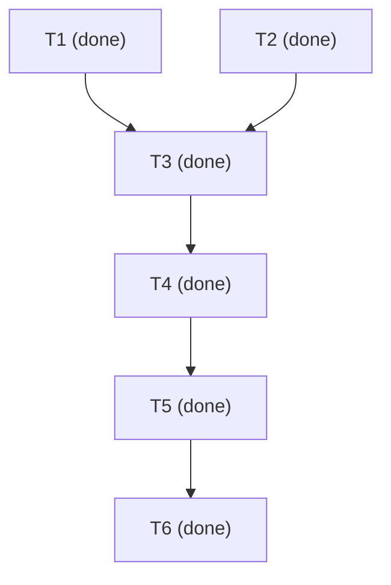

# Task DAG 도구 구현·검증

- 단계: T1–T6 완료. 구현·통합 검증과 독립 개발 리뷰 PASS.
- 근거: [요구사항 R1–R7](requirement.md), [설계](architecture.md). 두 단계 독립 리뷰 PASS.
- 통합 담당: lead(`/root`). 소스 기준 HEAD `bd656b1eed3d7800b7162ce97ea4dec0e5081540` + 기존 dirty 변경.
- 공유 기록: `.gsp-work/sessions/session-dag-fvbdcox3/work.md`. 병렬 worker에는 `/home/minjae/ws/gamjagoon-skills-pack/.gsp-work`와 실제 cwd를 전달한다.
- 미해결 사용자 결정·차단: 없음. DAG 16개·installer 6개 테스트 및 독립 개발 리뷰 PASS.

## 목차

- [작업과 검증](#작업과-검증)
- [DAG 정본](#dag-정본)
- [Task 계획 리뷰](#task-계획-리뷰)
- [실행 결과](#실행-결과)
- [최종 개발 리뷰](#최종-개발-리뷰)

## 작업과 검증

| ID | 요구사항 | 결과·소유 범위 | 완료 조건·검증 |
| --- | --- | --- | --- |
| T1 | R1–R5, R7 | code-worker: `task_dag.py`, `tests/test_task_dag.py` | 파서·schema·DAG·state·충돌·critical priority·실제 CLI와 합성 비교의 정상/오류 테스트. 별도 임시 작업 경로에서 구현하고 변경 두 파일과 실행 근거 인계 |
| T2 | R1, R6 | lead: schema reference, tasks/development/adopt/reviewer·AGENTS·README 지침 | 형식/CLI 예제와 실제 계약 일치, 생성→검증→현재 상태 갱신→배정 절차, Markdown·권한·증거 경계 유지 |
| T3 | R6–R7 | lead: installer와 설치 회귀 테스트 | 명시 목록 13파일, 불필요한 자료 미유입, 설치된 도구 validate/route 실행, 기존 충돌/backup/rollback 유지 |
| T4 | R1–R7 | lead: 통합·실행 검증과 결과 기록 | T1 후보를 허용 경로에 통합; 전체 관련 tests, 형식 검사, 자체 Task DAG의 validate/route/render, 설치 경로 실행과 소스 보존 확인 |
| T5 | R1–R7 | reviewer: 독립 development 검토, 파일 쓰기 없음 | 원문→현재 소스→실제 실행 근거 검토, 별도 임시 환경 검사, 결함 및 한계 반환 |
| T6 | R6–R7 | lead: 수정·필요한 재검증·문서 종결 | 필수 결함 종결과 실제 결과·미검증·사용법을 Markdown에 반영. 수정이 있으면 해당 T1–T5 범위를 다시 검증 |

T1과 T2는 검토된 설계를 입력으로 서로 다른 파일을 소유한다. T1 worker는 임시 복사본에만 쓰고 lead가 결과를 통합한다. T3부터는 두 결과를 받아 진행한다. 병렬 한도 2는 이번 구현에서 사용할 두 작업자(code-worker·lead)에 맞춘 값이며 pack의 기본값이 아니다. 시간 추정 근거가 없어 아래에는 소요 시간을 넣지 않는다.

## DAG 정본

<!-- GSP-DAG:START -->
```json
{
  "version": 1,
  "max_parallel": 2,
  "tasks": [
    {
      "id": "T1",
      "title": "DAG CLI와 단위·동작 검사",
      "deps": [],
      "status": "done",
      "owner": "code-worker",
      "reads": [
        "spec/dag-routing/requirement.md",
        "spec/dag-routing/architecture.md"
      ],
      "writes": [
        ".agents/skills/gsp-tasks/scripts/task_dag.py",
        "tests/test_task_dag.py"
      ],
      "resources": [],
      "evidence": "Integrated candidate hashes in .gsp-work/sessions/session-dag-fvbdcox3/received.json; worker 16 tests PASS, final combined checks in T4"
    },
    {
      "id": "T2",
      "title": "형식 설명과 워크플로 통합",
      "deps": [],
      "status": "done",
      "owner": "lead",
      "reads": [
        "spec/dag-routing/requirement.md",
        "spec/dag-routing/architecture.md"
      ],
      "writes": [
        ".agents/skills/gsp-tasks/references/task-dag.md",
        ".agents/skills/gsp-tasks/SKILL.md",
        ".agents/skills/gsp-development/SKILL.md",
        ".agents/skills/gsp-adopt/SKILL.md",
        ".codex/agents/gsp-reviewer.toml",
        "AGENTS.md",
        "README.md"
      ],
      "resources": [],
      "evidence": "DAG reference and workflow integration written; reference-check.json validates the actual example"
    },
    {
      "id": "T3",
      "title": "설치 목록과 회귀 검사",
      "deps": [
        "T1",
        "T2"
      ],
      "status": "done",
      "owner": "lead",
      "reads": [
        ".agents/skills/gsp-tasks/scripts/task_dag.py",
        ".agents/skills/gsp-tasks/references/task-dag.md"
      ],
      "writes": [
        "install.sh",
        "tests/test_install.py"
      ],
      "resources": [],
      "evidence": "checks.json: installer 6 tests PASS including installed validate/route/render, exact13-file payload, exclusions and late-write rollback"
    },
    {
      "id": "T4",
      "title": "통합 상태 실행 검증",
      "deps": [
        "T3"
      ],
      "status": "done",
      "owner": "lead",
      "reads": [
        "."
      ],
      "writes": [
        "spec/dag-routing/tasks.md"
      ],
      "resources": [],
      "evidence": "checks.json + dogfood.json: integrated22 tests, own plan validate/route/render, Python3.9 syntax, TOML and local links PASS"
    },
    {
      "id": "T5",
      "title": "독립 개발 리뷰",
      "deps": [
        "T4"
      ],
      "status": "done",
      "owner": "reviewer",
      "reads": [
        "."
      ],
      "writes": [],
      "resources": [],
      "evidence": "Native gsp-reviewer development PASS R1-R7: independent22 tests, installed CLI and DAG/graph comparison; see final review"
    },
    {
      "id": "T6",
      "title": "검증 결과와 인계",
      "deps": [
        "T5"
      ],
      "status": "done",
      "owner": "lead",
      "reads": [
        "spec/dag-routing"
      ],
      "writes": [
        "spec/dag-routing/tasks.md"
      ],
      "resources": [],
      "evidence": "Lead recorded independent review, checked source11 hashes and links, refreshed graph; final-state.json validates completed DAG and empty dispatch"
    }
  ]
}
```
<!-- GSP-DAG:END -->

초기 계획은 도구가 없어서 정적 구조 리뷰로 시작했다. 구현 후 이 문서에 실제 validate/route/render를 실행하여 부트스트랩 검증을 완료했다. 아래 표시는 현재 블록에서 생성한 파생 그래프다.

<!-- GSP-DAG-VIEW:START -->

<!-- GSP-DAG-VIEW:END -->

## Task 계획 리뷰

native gsp-reviewer, mode tasks, Sol medium: **PASS**. R1–R7→T1–T6 범위와 `{T1,T2} → T3 → T4 → T5 → T6`의 DAG 구조·병렬 소유권·검증 작업을 확인했다. 검토 계획 SHA256 `5cdc8e44b15f9e30ad71225d8737c614e656cecb5fdf12ba212cd47b1edb2ab8`와 관련 세 자료의 해시가 종료 시 동일했다. Lead는 결과를 수용한다. 도구 구현 전 정적 계획 검사이며 실제 도구 검증은 T4에서 수행한다.

## 실행 결과

| 검사 | 실제 결과 | 증거 범위 |
| --- | --- | --- |
| `python3 -B tests/test_task_dag.py -v` | 16/16 PASS | strict JSON/schema, DAG/cycle, 상태, 충돌, 2,500노드 체인, 결정성·부분 추정·실제 CLI |
| `python3 -B tests/test_install.py -v` | 6/6 PASS | 정확히13파일, 잡파일제외, installed validate/route/render, 충돌/backup 및 새도구 포함 rollback |
| 자기 Task 계획의 validate/route/render | PASS | 상태 변화 후 T3→T4→T5 실제 후보 선택; 실행 중 슬롯 반영 |
| schema reference 예제 validate | PASS | 배포 설명의 실제 예제가 도구 계약과 일치 |
| 스킬3개 validator, Bash 문법, diff, TOML, 링크 | PASS | 정적 형식·연결 확인 |
| Python3.9 문법 검사 | PASS | `ast.parse(feature_version=(3,9))`; 실제 실행은 Python3.13.14 |
| 합성 일정 비교 | ID순서8 → 긴경로우선6 시간단위 | 2worker, A/B 각2, Z→Y 각3 가정. t=3에서 Y를 시작하며 다른 작업 B 완료를 기다리지 않음 |

검사 로그: [checks.json](../../.gsp-work/sessions/session-dag-fvbdcox3/checks.json), [자체 계획 실행](../../.gsp-work/sessions/session-dag-fvbdcox3/dogfood.json), [예제 검사](../../.gsp-work/sessions/session-dag-fvbdcox3/reference-check.json), [worker 기록](../../.gsp-work/sessions/session-dag-code-8gycn_ov/work.md). 로컬 Git 제외 경로이므로 다른 checkout에서는 unavailable일 수 있다.

합성 비교는 동일한 작업·의존·가상시간·capacity에서 배정 순서만 비교한 테스트다. 실제 프로젝트 속도 개선·최적해 증거가 아니다. Python3.9 런타임, 다른 OS, 새 Codex 세션의 실제 agent 배정, Mermaid 브라우저 렌더링, 원격 배포는 NOT_RUN. 도구는 Mermaid 텍스트를 출력하며 HTML은 생성하지 않는다.

## 최종 개발 리뷰

native `gsp-reviewer` / `gpt-6.1-sol` medium, mode development: **PASS** — R1–R7/T1–T5. 확정 결함·필수 미검증·사용자 결정 없음. 이전 단계 PASS와 별도로 현재 소스와 실행 근거를 검토했다.

별도 `/tmp/gsp-dag-independent-2wwmmokc` 복사본에서 Python3.13.14로 DAG16/16·installer6/6 테스트, Bash 문법, 원본 diff 검사, 현재 Task문서 validate/route/render와 Mermaid 일치, reference 예제 validate를 직접 확인했다. 설치된 CLI, 잡파일 제외, 사용자 충돌/backup 및 새 도구 설치 이후 실패의 rollback이 포함된다. 이전 T3→T4→T5 선택 로그는 저자 실행 근거로 구분했다.

검토한 source11개는 review.json과 일치하며 단계·증거 자료를 포함한23파일이 검사 전후 동일했다. 검토 당시 Task 문서 SHA256은 `b1448c45e61b8566529c655e949b65c986de3657475e0d119a30f0bc457830cb`이며 T5 running/T6 pending 상태였다. 이후 lead가 리뷰 기록과 T5/T6 상태 및 파생 그래프를 갱신하고 최종 validate/route/render로 재확인했다. 이 마지막 상태 갱신은 저자 확인이며 독립 리뷰를 다시 실행한 것은 아니다.

Lead comment: 결과를 수용한다. 추가 수정 대상은 없으며 전체 필수 요구를 완료로 기록한다. 위 미검증 한계는 유지하고, 구조 검증과 독립 테스트를 실제 프로젝트 속도 개선이나 자동 agent 실행의 증거로 확대하지 않는다.
